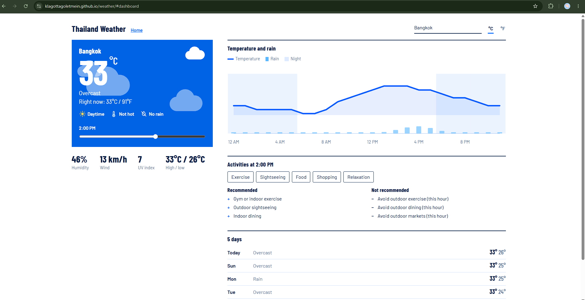
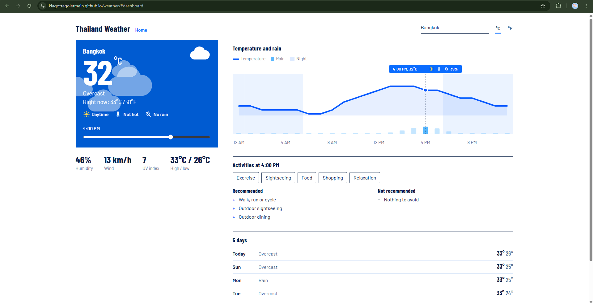
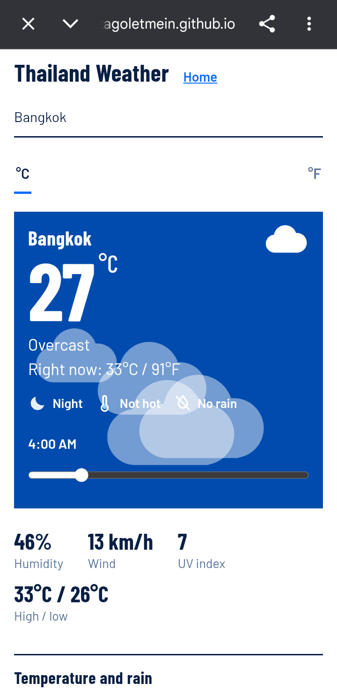

# Thailand Weather

เว็บดูสภาพอากาศของทุกจังหวัดในไทย ที่ไม่ได้บอกแค่อุณหภูมิ แต่บอกด้วยว่าชั่วโมงที่เลือกควรทำอะไรและควรเลี่ยงอะไร

**ลองใช้ได้ที่:** https://klagottagoletmein.github.io/weather/

## ทำไมถึงทำ

ผมเริ่ม project นี้จากการสงสัยว่าผมจะดึงข้อมูลจาก API จริงมาแสดงบนหน้าเว็บได้อย่างไร ผมเลือกข้อมูลสภาพอากาศจาก Open-Meteo แล้วต่อยอดเป็นกราฟรายชั่วโมงที่วาดเองด้วย SVG และระบบแนะนำกิจกรรมตามช่วงเวลา

## ทำอะไรได้บ้าง

- **กราฟรายชั่วโมงที่วาดเองด้วย SVG** ไม่ได้ใช้ไลบรารีกราฟ มีเส้นอุณหภูมิ แท่งโอกาสฝน แถบกลางคืน และเส้นบอกว่าร้อนตั้งแต่กี่องศา เอาเมาส์วางหรือลากนิ้วบนกราฟเพื่อดูทีละชั่วโมงได้
- **แนะนำกิจกรรมตามชั่วโมงและความสนใจ** เลือกได้ว่าสนใจออกกำลังกาย เที่ยว กิน ช้อปปิ้ง หรือพักผ่อน แอปจะบอกว่าอะไรควรทำและอะไรควรเลี่ยง จากอุณหภูมิ ฝน UV และช่วงเวลาของวัน
- **ครบทุกจังหวัด** พิมพ์ค้นหาได้
- **ข้อมูลสดจาก Open-Meteo** มีอุณหภูมิจริงตอนนี้ และอัปเดตใหม่ทุก 10 นาที
- **สลับ °C / °F ได้** บรรทัด "Right now" แสดงทั้งสองหน่วย
- **พยากรณ์ 5 วัน**
- **ปรับตามขนาดจอ** จอกว้างแบ่งสองคอลัมน์ จอเล็กเป็นคอลัมน์เดียว

เลขใหญ่บนการ์ดจะเปลี่ยนตามชั่วโมงที่เลือกด้วยสไลเดอร์ (เป็นค่าพยากรณ์ของชั่วโมงนั้น) ส่วนบรรทัด "Right now" คืออุณหภูมิจริงตอนนี้

## วิธีใช้

1. เปิดลิงก์ด้านบน แล้วพิมพ์ค้นหาจังหวัดที่ต้องการ
2. เลื่อนสไลเดอร์หรือลากบนกราฟเพื่อเลือกชั่วโมง
3. กดปุ่มความสนใจ เพื่อให้คำแนะนำตรงกับสิ่งที่อยากทำ

ถ้าอยากรันในเครื่อง โหลดไฟล์ `index.html` แล้วเปิดด้วยเบราว์เซอร์ได้เลย ไม่ต้อง build แต่ต้องต่ออินเทอร์เน็ตถึงจะได้ข้อมูลสด

## หน้าจอบนมือถือ

## เทคโนโลยีที่ใช้

- HTML, CSS, JavaScript ล้วน (ไฟล์ `index.html` ไฟล์เดียว)
- [Open-Meteo](https://open-meteo.com/) API
- โฮสต์บน GitHub Pages

## โค้ดทำงานยังไง (สรุปสั้นๆ)

- `loadWeather` ดึงข้อมูลปัจจุบัน รายชั่วโมง และรายวัน โดยโชว์ข้อมูลตัวอย่างก่อนเพื่อไม่ให้หน้าจอว่าง แล้วค่อยเปลี่ยนเป็นข้อมูลจริง และมีตัวนับ request กันกรณีเปลี่ยนจังหวัดระหว่างรอ ข้อมูลของจังหวัดเก่าจะไม่มาทับ
- `drawChart` แปลงข้อมูล 24 ชั่วโมงเป็นพิกัด SVG แล้ววาดกราฟใหม่ทุกครั้งที่ข้อมูล หน่วย หรือขนาดหน้าต่างเปลี่ยน
- `ACTIVITIES` กับ `getAdvice` เก็บกฎแนะนำกิจกรรมเป็นข้อมูล แต่ละกิจกรรมมีเงื่อนไข ข้อความ และตัวเลือกสำรอง เพิ่มกิจกรรมใหม่ได้โดยไม่ต้องแก้ตรรกะหลัก

## ส่วนที่ผมทำเอง / ส่วนที่ใช้ AI ช่วย

<!-- แก้ส่วนนี้ให้ตรงกับความจริงก่อนเผยแพร่: ย้ายข้อความไปมาระหว่างสองรายการ -->

**ผมทำเอง**
- ไอเดียและแนวคิดของแอป (แนะนำว่าควรทำอะไรตามชั่วโมง ไม่ใช่แค่ตัวเลข)
- เลือกฟีเจอร์ หน้าตา และข้อมูลที่จะแสดง
- ทดสอบ นำขึ้นเว็บ และเขียนเอกสาร

**ใช้ AI ช่วย**
- การเชื่อมต่อ Open-Meteo API เพื่อความรวดเร็ว
- จัดโค้ดให้อ่านง่าย
- layout ที่ปรับตามขนาดจอ และการอัปเดตอุณหภูมิจริง
- ร่างแรกของกราฟ SVG และกฎแนะนำกิจกรรม

## ข้อจำกัดและสิ่งที่อยากปรับต่อ

<!-- ลบข้อที่ไม่จริงหรือไม่ได้ตั้งใจจะทำ -->

- เกณฑ์ต่างๆ เช่น 33 °C ถือว่าร้อน หรือ UV 8 ถือว่าแดดแรง เป็นค่าประมาณ ยังไม่ได้อ้างอิงแหล่งทางการ
- ถ้าดึงข้อมูลจาก API ไม่สำเร็จ แอปจะแสดงข้อมูลตัวอย่างต่อโดยไม่มีข้อความแจ้ง
- เส้นอุณหภูมิบนกราฟใช้ค่าที่ปัดเป็นจำนวนเต็มแล้ว เส้นเลยเป็นขั้นๆ ไม่เรียบ
- ตอนลากบนกราฟ หน้าทั้งหน้าถูกวาดใหม่ทุกครั้งที่เมาส์ขยับ ยังไม่ได้ทำให้เบาลง
- สไลเดอร์ชั่วโมงใช้คีย์บอร์ดได้ แต่ tooltip บนกราฟยังไม่ขึ้นตอนใช้สไลเดอร์ และ screen reader ยังอ่านค่าตามชั่วโมงที่เลือกไม่ได้
- ยังไม่มี test อัตโนมัติ

## เครดิต

ข้อมูลสภาพอากาศจาก [Open-Meteo.com](https://open-meteo.com/)
